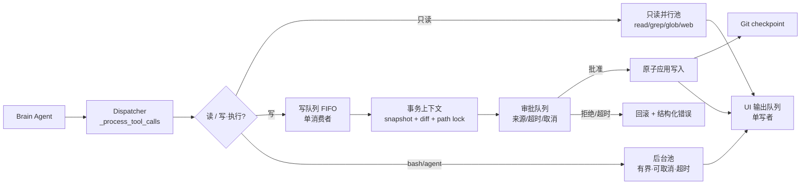

# Aider 的串行事务模型对 Sebastian 并发多 Agent 的启发

> 对比对象：Aider 0.86.3.dev（上游 `5dc9490bb`）与 Sebastian v1.0.0  
> 性质：设计对比与借鉴路线图  
> 日期：2026-10-30  
> 实施状态：提示符重绘 + 终端 HITL 已落地；Tk/GUI 与 eval 模块已删除；单写者/队列仍是后续建议。  
> 注意：本文的“Sebastian 现状”部分保留改造前快照，用于解释问题来源；当前实现见 TODO.md。

## 0. 摘要与决策建议

先说结论：

1. **Aider 的工具执行是串行的，但这不是“能力缺陷”**，而是把副作用收敛成可解释事务的主动选择。它一次只改一处、一次只提交一次、一次只确认一次，所以状态永远可回滚。
2. **Sebastian 的并发优势在只读探索和长任务**：多个子 Agent 可以并行读代码、搜索、分析、跑只读命令。这部分不应该被 Aider 的串行模型替换。
3. **Sebastian 真正需要收敛的是四类副作用**：写文件、危险工具审批、终端输出、Git 提交。它们目前没有统一的单写者边界，才是并发风险的来源。

建议的改造方向不是“去掉并发”，而是：

> **并行只读 + 单写者执行 + 单 UI 队列。**

| 决策 | 建议 | 理由 |
|---|---|---|
| 保留多 Agent 并发 | 是 | 只读探索、子任务隔离是 Sebastian 的核心价值 |
| 取消所有并发 | 否 | 会把 Sebastian 退化成 Aider 的单 Agent 串行壳 |
| 写操作单写者 | 是，P0 | 消除并发写丢更新、符号链接 TOCTOU、后台写饥饿 |
| 审批队列化 | 是，P0 | 当前全局锁无队列、无来源、无超时，多 Agent 会无限排队 |
| 终端输出汇流 | 已实现最小版 | 流式 token 与后台日志现已走 `ui_redraw`；审批队列仍未实现 |
| Git 事务化 | 是，P1 | 提供 checkpoint、diff、undo、崩溃恢复 |
| 编辑契约强化 | 是，P1 | 当前只有整文件覆盖或单段字面替换 |
| repo map | 先 Python-only，P2 | 收益依仓库规模而定，不要一步引入 tree-sitter/networkx |
| 复制 Aider 单 Coder 串行壳 | 否 | 会丢掉多 Agent 编排与并行探索 |

## 1. 第一性差异：调度器 vs 事务引擎

### 1.1 Aider 的串行在保证什么

Aider 的主循环是单 Coder 的固定流水线：

```text
用户输入 → 组装上下文 → 调 LLM → 解析补丁 → 写文件 → Git 提交 → lint/test → 反射重试
```

它的 shell 命令也是顺序执行的：`run_shell_commands()` 遍历命令块，逐个命令块确认，块内命令再逐条执行（`aider/coders/base_coder.py:2434-2478`）。多个编辑块同样按顺序应用（`aider/coders/base_coder.py:2296-2336` 的 `apply_updates()`）。

Aider 选择串行，是为了保证三件事：

- **写入顺序确定**：多个编辑块不会同时争抢同一文件。
- **确认顺序确定**：每次危险操作都能在终端里得到一次明确回答。
- **回滚点确定**：每次成功修改都对应一次 Git 提交（`aider/repo.py:131-318`）。

这不是“不会并发”，而是“副作用必须一次一个”。

### 1.2 Sebastian 的并发在哪里真正有价值

Sebastian 的并发主要来自两层：

- **Brain 调度多个子 Agent**：CodeWriter、CodeReviewer、TestRunner、WebSearchAgent 各自有独立上下文，任务完成即销毁（`src/tools/toolkits/subagent.py:137-180`）。
- **后台任务**：`bash` 和 `agent` 带 `run_in_background=true` 时，由 `AgentRunner.start_background_task()` 起 daemon 线程（`src/agent_runner.py`）。

这些并发在**只读探索**上收益最大：一个子 Agent 读代码，另一个查资料，另一个跑只读测试，Brain 不必排队等它们。

问题在于：同一套后台线程也被用于**写文件**。`write` / `edit` 一旦进入后台子 Agent，就可能与其他子 Agent 并发写同一路径。

### 1.3 不要用“并发/串行”做价值判断

| 维度 | Aider | Sebastian |
|---|---|---|
| 优化目标 | 单任务的确定性与可回滚 | 多任务的吞吐与职责隔离 |
| 强项 | 事务、上下文工程、编辑契约 | 编排、并行探索、安全沙箱、长期记忆 |
| 弱项 | 吞吐、长任务并行、多 Agent 协作 | 写路径原子性、审批公平性、输出一致性 |
| 该学的 | 事务边界、编辑契约、repo map | 不适用“全盘照搬” |

Aider 值得学的不是“串行”，而是**它如何把串行变成可解释的事务**。

## 2. Sebastian 现状：五个断面

### 2.1 写路径

- `write()` 用 `O_TRUNC` 整文件覆盖，没有备份、没有 diff（`src/tools/toolkits/write.py:7-22`）。
- `edit()` 是“读全文 → 字面替换 → 写回”，普通 `open(w)`，没有 `O_NOFOLLOW`，也没有按路径加锁（`src/tools/toolkits/edit.py:65-89`）。
- 后台线程没有并发上限、没有取消、没有 wall-clock 超时（`src/agent_runner.py`）。
- 两个子 Agent 同时 `edit` 同一文件时，后写者会覆盖前写者的结果；`write` 的 `O_NOFOLLOW` 只解决符号链接，不解决丢更新。

**典型故障**：子 Agent A 读到旧内容，子 Agent B 先写入新内容，A 再写回旧内容，B 的修改丢失。

### 2.2 审批

- `terminal_confirm()` 用 `TERMINAL_IO_LOCK` 串行审批，`terminal_question()` 共用同一把锁；同一时刻只有一个提示符读取 stdin。
- HITL 钩子会传 `agent_name`，审批提示能显示来源；但 HITL 调用未传 `timeout`，默认无超时。
- 异步日志通过 `ui_redraw` 擦行/重绘，不会冲散提示符；`ui_redraw` 只处理视觉，不替代输入锁。
- 后到审批会阻塞等待；当前没有 FIFO 队列位次，用户只看到“另一个审批正在等待”。

**典型故障**：三个子 Agent 同时请求 `write` 审批；后到者等待当前提示符结束，确认行不会被日志冲散，但用户看不到队列位次。

### 2.3 输出（改造前）

- `cli.py` 的流式 token 直接 `typer.echo(..., nl=False)`（`cli.py:353-355`）。
- 后台任务启动/完成、子 Agent 的 `[TOOL]` 日志直接 `typer.echo`（`src/agent_runner.py,259,306-309`）。
- `TERMINAL_IO_LOCK` 只保护终端输入（`src/utils/interaction.py:17`），不保护普通输出。

**典型故障**：Brain 正在流式输出半行文字，后台子 Agent 插入一条 `[background done]`，终端出现交错。

### 2.4 上下文

- 上下文是单一扁平列表；system 在每轮 `run_stream()` 开始时由 `_ensure_system_prompt()` 重建（`src/agent_runner.py,459`）。
- `todo` 调用会在同一轮内改写 system 里的 `<当前任务计划>`（`src/agent_runner.py`），这会让 system 前缀不稳定。
- 三层压缩：L1 单条工具结果 5% 窗口落盘、L2 总量 50% 微压缩、L3 总量 75% LLM 摘要，保留近期 8% 预算（`src/utils/compaction_pipeline.py:29-32`）。
- 没有显式的 prompt cache 分段或 `cache_control`。

**典型故障**：todo 每更新一次，system 前缀就变化一次；如果 provider 按前缀缓存，缓存命中率会被拉低。

### 2.5 Git

- 应用层没有 Git 集成：没有 checkpoint、auto-commit、undo、diff、脏区处理。
- 只能通过 `bash` 手动执行 Git；命令守卫还会拦截 `git clean`（`src/security/command_guard.py:142-145`）。
- 文件修改没有事务边界，崩溃后只能靠用户自己 `git status` / `git diff` 排查。

**典型故障**：子 Agent 改坏文件后，用户无法一键回滚到“这次任务开始前”。

### 2.6 五个断面的共同点

| 断面 | 当前状态 | 风险 |
|---|---|---|
| 写 | 多线程可并发写同一路径 | 丢更新、TOCTOU |
| 审批 | 全局锁串行，但无队列/来源/超时 | 无限排队、误批 |
| 输出 | 改造前无统一输出锁 | 半行交错；现已接提示符重绘 |
| 上下文 | system 前缀会被 todo 改写 | 缓存不命中、指令漂移 |
| Git | 无事务层 | 无法撤销、无法审计 |

## 3. Aider 机制解构：哪些成立，哪些有前提

### 3.1 八段上下文与缓存边界

Aider 把消息拆成八个槽位，最终顺序是：

```text
system → examples → readonly_files → repo → done → chat_files → cur → reminder
```

`ChatChunks.all_messages()` 定义顺序（`aider/coders/chat_chunks.py:14-26`），`add_cache_control_headers()` 只切三处：examples、repo、chat_files（`aider/coders/chat_chunks.py:25-44`）。

**成立前提**：provider 按前缀缓存，且稳定内容确实放在前面。  
**成本**：分段逻辑复杂，历史摘要和文件内容要按稳定性排序。  
**对 Sebastian**：先做“system 稳定、todo/通知移出 system”，再验证 provider 是否支持缓存控制；不要直接假设 `cache_control` 可用。

### 3.2 编辑契约与错误反射

Aider 默认用 SEARCH/REPLACE 块，解析器在 `aider/coders/editblock_coder.py:439-535`，模糊匹配在 `aider/coders/editblock_coder.py:157-329`。失败时构造带 `did-you-mean` 的错误文本，塞回 `reflected_message`，`run_one()` 最多重试 3 次（`aider/coders/base_coder.py:924-944`）。

**成立前提**：模型愿意遵守文本格式，且错误文本足够可操作。  
**成本**：解析器和模糊匹配复杂；格式错误会浪费一轮。  
**对 Sebastian**：不需要复制 SEARCH/REPLACE 文本格式；应强化结构化 `edit` 工具（多 hunk、fuzzy、diff 反馈），但保留“失败返回可操作错误，而不是中止整批”的思想。

### 3.3 Git 自动提交

Aider 每次成功编辑后自动提交；编辑前如果有未提交改动，先做 dirty commit（`aider/repo.py:131-318`，`aider/coders/base_coder.py:2375-2395`）。`/undo` 只撤销本会话 aider 产生的、未 push 的、非 merge 的提交。

**成立前提**：单 Coder、文件系统是主要副作用、用户接受小提交。  
**成本**：提交噪声；不能覆盖 bash/cron/MCP 的外部副作用。  
**对 Sebastian**：以“逻辑任务/工具批次”为事务单位，而不是每次编辑都提交；Git 只能覆盖文件副作用，cron/MCP/网络副作用要单独审计。

### 3.4 repo map

Aider 用 tree-sitter 抽 def/ref，建引用图，PageRank 排序，再二分 token 预算（`aider/repomap.py:365-574,629-706`）。排序单位是函数/类定义，不是文件；聊天文件会被跳过（`aider/repomap.py:554-557`）。

**成立前提**：仓库足够大，模型自己 `ls/grep/read` 的成本高；有稳定的标签抽取。  
**成本**：tree-sitter、图算法、缓存维护；多语言支持复杂。  
**对 Sebastian**：先做 Python-only 的 AST 索引（标准库 `ast`），按 Agent、按 token 预算注入；不要全量注入所有子 Agent。

### 3.5 lint/test 反射

Aider 在编辑后跑 lint/test，把错误文本作为下一轮用户消息，最多 3 次（`aider/coders/base_coder.py:1599-1624`）。没有独立的“批评者模型”。

**成立前提**：有可执行的检查命令，错误文本对模型可操作。  
**成本**：需要配置 lint/test，错误可能很长。  
**对 Sebastian**：用 `PostToolUse` 钩子做有界验证；复用 TestRunner 子 Agent；一个工具失败不应中止整批 tool_calls。

### 3.6 弱模型 / editor 模型

Aider 用弱模型生成 commit message，历史摘要也优先用弱模型（`aider/models.py:622-645`、`aider/coders/base_coder.py:510-513`）；architect 模式用 editor 模型执行编辑。

**成立前提**：多模型成本差异明显，任务可拆分。  
**成本**：模型路由和一致性维护。  
**对 Sebastian**：可以先把“摘要/提交信息/验证”路由到便宜模型，但不要为了模仿 Aider 而引入不必要的模型角色。

## 4. 单写者事务层：Sebastian 的核心改造方向

### 4.1 设计原则

> **并行只读，串行写；审批和输出也走单写者队列。**

- 读工具（`read`、`grep`、`glob`、`ls`、`web_search`、`web_fetch`）可以并行。
- 写工具（`write`、`edit`、会改文件的 `bash`）必须经过同一个执行队列。
- 审批和输出不直接由子 Agent 线程操作终端，而是投递到 UI 队列。
- 后台池有界、可取消、有超时；不能无限起 daemon 线程。

### 4.2 组件

| 组件 | 职责 | 关键接口 |
|---|---|---|
| Tool capability | 标记工具是只读还是写入 | `is_mutating(tool_name, args)` |
| MutationQueue | FIFO 单消费者，按仓库/路径加锁 | `submit(op) -> Future` |
| ApprovalQueue | 审批请求排队，显示来源 Agent | `ask(req) -> bool` |
| OutputBroker | 单写者输出，整行原子写，按 Agent 标签 | `emit(agent, text)` |
| BoundedPool | 有界后台线程池 | `submit(fn) -> Future` |
| GitTransaction | checkpoint、diff、提交、回滚 | `begin/commit/rollback` |

### 4.3 一次写入的完整流程

```text
子 Agent 请求 write/edit
  → 工具能力判定：mutating
  → MutationQueue 入队（带 agent_name、path、idempotency key）
  → 审批队列：显示来源 Agent、参数、超时/取消
  → 批准后获取 per-path 锁
  → 重新读取文件（防止审批期间被改）
  → 应用写入 + 生成 diff
  → Git checkpoint/commit（按事务策略）
  → 返回结构化结果（success/diff/error）
  → OutputBroker 输出一行摘要
```

关键细节：

- **审批前不要长时间持有路径锁**：先审批，再拿锁；拿锁后重新读取并校验版本，避免审批期间文件被改。
- **失败不中止整批**：一个写失败返回结构化错误，同批其他独立工具继续；这与当前 `aborted=True` 的行为不同（`src/agent_runner.py`）。
- **幂等键**：同一 `tool_call_id` 重试时不重复写入。

### 4.4 失败语义

| 失败 | 处理 |
|---|---|
| 审批拒绝 | 返回结构化拒绝，不写文件，不锁队列 |
| 审批超时 | 默认拒绝；记录来源 Agent 和等待时长 |
| 路径被并发修改 | 重新读取后校验；失败则返回“请重试”，不覆盖 |
| 写入异常 | 回滚该事务，保留其他已完成事务 |
| Git 提交失败 | 保留文件改动，标记事务未提交，提示用户 |
| 后台任务超时 | 取消/标记失败；结果队列保留错误状态 |

### 4.5 死锁、饥饿与取消

- 不要在等待人工审批时持有路径锁；审批完成后释放审批锁，再获取路径锁和 Git 锁。若确实需要嵌套，顺序固定为**路径锁 → Git 锁**，不允许反向。
- MutationQueue 使用 FIFO + 超时，避免某个 Agent 永久占队列。
- 后台池有界（例如 `max_workers=4`），超出排队；不允许无限创建 daemon 线程。
- 每个任务带取消令牌；用户 `/quit` 或 Ctrl-C 时统一取消。
- （后续可选）审批与输出共用一个 UI 仲裁器；当前只有 `TERMINAL_IO_LOCK` 串行输入，没有队列。

### 4.6 目标结构



## 5. 上下文与代码理解：Aider 的第二层经验

### 5.1 稳定前缀与 cache-aware

Sebastian 当前 system 会在每轮开始时重建，todo 更新还会改写 system 前缀（`src/agent_runner.py,459`）。建议：

1. 把 system 拆成**稳定段**（角色、安全规则、工具说明）和**易变段**（todo、cron、后台通知）。
2. todo/通知不要写入 system，改为独立的 reminder/user 消息。
3. 先稳定前缀，再按 provider 验证 `cache_control` 或自动缓存；不要假设所有 provider 都支持。

### 5.2 repo map：先 Python AST，不要一步到位

Aider 的 tree-sitter + PageRank 很完整，但 Sebastian 不必一次复制：

- 第一版：用标准库 `ast` 解析 Python 文件，建“文件 → 函数/类 → 引用”索引。
- 排序：按被引用次数、是否在聊天文件、是否被任务提及加权。
- 预算：按 token 预算裁前 N 个符号；只给需要的子 Agent。
- 第二版：如果多语言需求明确，再引入 tree-sitter；不要先引入 networkx。

验收指标：大仓库首轮定位耗时、注入 token、任务成功率；没有实测数字就不要宣称“提升”。

### 5.3 压缩与摘要的协同

Sebastian 已有三层压缩（`src/utils/compaction_pipeline.py:29-32`），比 Aider 的单一历史摘要更完整。引入 Aider 经验时不要破坏它：

- 摘要边界要稳定：不要把稳定前缀反复摘要。
- 压缩后保留 system、最近用户轮、最近工具周期。
- 对 repo map 注入的内容单独计费/计量，避免压缩后重复注入。

### 5.4 可度量指标

| 指标 | 采集方式 |
|---|---|
| 并发写丢更新次数 | 两子 Agent 写同一文件 100 次，比较最终内容 |
| 审批等待时长/超时率 | 记录入队、提示符、决策、释放锁时间 |
| 输出交错次数 | 流式 + 后台日志压测，检查半行/标签错位 |
| 首轮定位 token/耗时 | 有/无 repo map 对比 |
| 缓存命中率 | 若 provider 返回 cache read tokens，记录前后变化 |
| 任务成功率 | 固定回归用例，比较改造前后 |

## 6. 不建议照搬的四件事

1. **不要把 Sebastian 改成单 Coder 串行**：会丢掉多 Agent 编排和并行只读探索，这是 Sebastian 的核心价值。
2. **不要用全量 SEARCH/REPLACE 契约替代结构化 edit 工具**：多 Agent 场景会放大格式失败和 token 浪费；结构化 JSON 更适合工具调用。
3. **不要把 Git 当成唯一回滚手段**：它只覆盖文件系统；bash、cron、MCP、网络副作用不在 Git 里。
4. **不要把 repo map 全量注入每个子 Agent**：会重复计费、挤占预算；应按 Agent、按需、按 token 预算注入。

## 7. 对照表

| 维度 | Aider | Sebastian | 对 Sebastian 的启示 |
|---|---|---|---|
| 执行模型 | 单 Coder 串行 | Brain + 子 Agent，后台线程 | 保留并发，但写操作收敛 |
| 写路径 | 编辑块顺序应用 | write/edit 可被后台并发调用 | 单写者 + 路径锁 |
| 失败语义 | 错误文本反射，最多 3 次 | 工具失败中止整批 | 局部失败不拖垮整批 |
| 回滚 | Git 自动提交 + `/undo` | 无应用层 Git | 事务化 checkpoint |
| 审批 | 终端逐块确认 | 改造前：全局锁 + 弹窗；现在：终端 + `TERMINAL_IO_LOCK` | 后续可选：队列 + 位次 + 超时 |
| 输出 | 主循环单线程，输出基本串行 | 多线程 + 无输出锁 | OutputBroker |
| 上下文 | 八段 + 缓存切点 | 扁平列表 + 三层压缩 | 稳定前缀 + 分段 |
| 代码理解 | repo map | ls/grep/glob/read | Python AST 索引 |
| 质量闭环 | lint/test 反射 | 有 TestRunner 子 Agent | PostToolUse 验证 |
| 模型分工 | 主/弱/editor | 每 Runner 可指定模型 | 按任务路由，不盲目加角色 |
| 扩展/编排 | 编辑格式注册表 | Markdown 子 Agent 注册 | 保留声明式扩展 |
| 可观测性 | 单线程日志 | 多线程日志交错 | 统一输出与审计 |

## 8. 分阶段路线图

### Phase 0：基线与故障复现

- 目标：用数据确认问题，而不是凭直觉改造。
- 动作：记录并发写、审批等待、输出交错、首轮定位 token 的可复现步骤。
- 验收：每个故障有最小复现脚本/命令；P0 范围冻结。
- 风险：不要在基线之前引入大重构。

### Phase 1：单写者 + 审批队列 + 输出汇流 + 有界并发

- 涉及：`src/agent_runner.py,263-355`、`src/tools/toolkits/write.py`、`src/tools/toolkits/edit.py`、`src/utils/interaction.py`、`src/utils/ui_redraw.py`、`cli.py`。
- 目标：写路径、审批、输出都有单写者/单队列；后台线程有界、可取消。
- 验收：
  - 两子 Agent 并发写同一文件 100 次，无丢更新。
  - 三个审批同时到达，队列显示来源，超时可取消，无死锁。
  - 流式输出 + 后台日志压测 10 分钟，无半行交错。
- 风险：吞吐下降、审批等待体验变化；先量化再调参。

### Phase 2：Git 事务化

- 涉及：新增 `src/utils/git_transaction.py`；`src/agent_runner.py` 写入提交点；`cli.py` 增加 `/undo`、`/diff`。
- 目标：每次逻辑任务/工具批次有 checkpoint、diff、可回滚。
- 验收：可 undo 到事务点；无关脏区/未跟踪文件不被误提交；后台写同样入事务。
- 风险：提交噪声、脏区处理复杂；Git 不覆盖 bash/cron/MCP 副作用。

### Phase 3：编辑契约 + 验证闭环

- 涉及：`src/tools/toolkits/edit.py`、`src/tools/toolkits/write.py`、`src/prompts/`、`src/hooks/`、`src/agents/subagents/test-runner.md`。
- 目标：多 hunk/fuzzy/diff 反馈；编辑失败不中止整批；编辑后按需跑 lint/test 并限次回灌。
- 验收：fuzzy 用例通过；失败返回可操作 diff；lint/test 错误可回灌且最多 3 次。
- 风险：模糊匹配误改；必须有 diff 预览与回退。

### Phase 4：repo map + cache-aware 上下文

- 涉及：新增 `src/utils/repo_map.py`；`src/agent_runner.py`；`src/utils/compaction_pipeline.py`。
- 目标：Python-only 符号索引；system 稳定前缀；按 Agent 注入。
- 验收：大仓库首轮定位 token/耗时下降；system 前缀稳定；任务成功率无回归。
- 风险：索引维护成本；provider 缓存能力不一；不要给未实测的收益数字。

## 9. 风险、Caveat 与待验证问题

- **Aider 的串行不是“串行即安全”**：它依赖提示词、编辑契约、Git 和用户确认；去掉这些，串行也会出错。
- **Sebastian 的并发是核心价值**：本文主张“收敛写与 UI”，不是“取消并发”。
- **代码快照**：审批全局锁、无超时等结论基于当前代码；重构前应重新确认。
- **repo map / cache 的收益依仓库规模、语言、provider 而异**：禁止把未实测的数字写进结论。
- **单写者会带来吞吐损失**：先测量，再决定队列粒度（全局队列 vs 按仓库/路径）。
- **Git 只覆盖文件系统副作用**：bash、cron、MCP、网络副作用需要单独审计。
- **审批超时是 UX 决策**：默认拒绝更安全，但可能让长任务失败；需要可配置。

待验证清单：

1. 两个后台子 Agent 同时 `edit` 同一文件，是否稳定复现丢更新？
2. 三个子 Agent 同时请求审批，第二个/第三个的等待时长和最终结果？
3. Brain 流式输出时，后台任务日志是否会出现半行交错？
4. todo 改写 system 前缀前后，provider 的 cache 命中率变化？
5. 加上 Python AST repo map 后，大仓库首轮定位的 token/耗时变化？

## 10. 证据索引

### Aider

- `aider/coders/base_coder.py:510-513`：历史摘要的模型列表（弱模型优先）。
- `aider/coders/base_coder.py:924-944`：反射循环，最多 3 次。
- `aider/coders/base_coder.py:1599-1624`：lint/test 反射接入点。
- `aider/coders/base_coder.py:2296-2336`：`apply_updates()` 顺序应用编辑。
- `aider/coders/base_coder.py:2434-2478`：shell 顺序执行与确认。
- `aider/coders/editblock_coder.py:41-124`：应用编辑与失败反馈。
- `aider/coders/editblock_coder.py:157-329`：模糊匹配。
- `aider/coders/editblock_coder.py:439-535`：SEARCH/REPLACE 解析。
- `aider/coders/chat_chunks.py:4-44`：八段消息与缓存切点。
- `aider/models.py:622-645`：commit message 模型与 editor 模型选择。
- `aider/repo.py:131-318`：自动提交与归属。
- `aider/repomap.py:365-574`：建图与 PageRank。
- `aider/repomap.py:629-706`：token 二分预算。
- `aider/history.py:27-97`：历史摘要。

### Sebastian

- `src/agent_runner.py`：system 重建与 todo 改写。
- `src/agent_runner.py`：后台线程无上限。
- `src/agent_runner.py`：tool_calls 串行、失败中止整批。
- `src/agent_runner.py`：每轮开始时重建 system。
- `src/utils/interaction.py:17`：`TERMINAL_IO_LOCK` 串行所有终端输入。
- `src/utils/interaction.py:78,126`：终端审批/提问入口。
- `src/utils/ui_redraw.py`：异步日志擦行/重绘提示符。
- `src/hooks/pre_tool_use/02_hitl_hook.py:49`：HITL 传 agent_name，但未传 timeout。
- `src/tools/toolkits/write.py:7-22`：整文件覆盖、无备份/diff。
- `src/tools/toolkits/edit.py:65-89`：字面替换、多处匹配失败。
- `src/utils/compaction_pipeline.py:29-32`：三层压缩阈值。
- `src/tools/toolkits/subagent.py:137-180`：子 Agent 调度与工具注册。
- `src/security/command_guard.py:142-145`：`git clean` 拦截。

---

**一句话总结**：Aider 教给 Sebastian 的不是“串行”，而是“把副作用收敛成可解释的事务”；Sebastian 应该继续并行地思考，但串行地改变世界。
